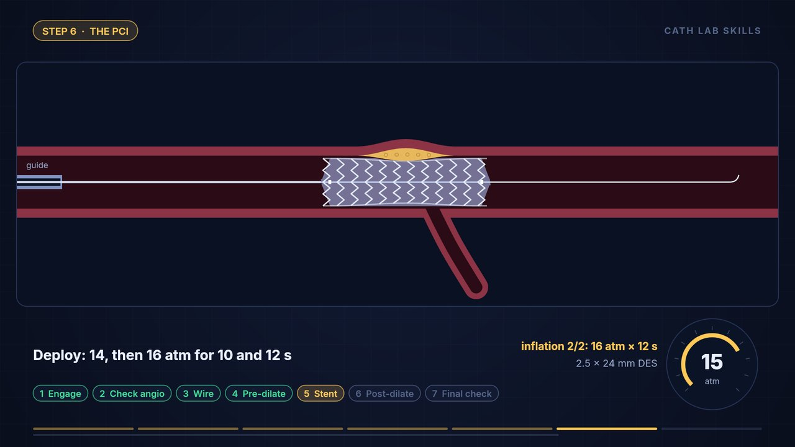

# Cath Lab Skills — narrated teaching animation

A 13.7-minute, 1080p animated video with voice narration. It teaches a reusable
**7-step approach to a cath case**, using one real (de-identified) case as the thread:
a **pharmaco-invasive PCI to the LAD** after an anterior-wall STEMI.

**Watch:** [`cath-skills-pharmacoinvasive-pci-lad.mp4`](./cath-skills-pharmacoinvasive-pci-lad.mp4)
(English captions are embedded; also in [`captions.srt`](./captions.srt)).



## What it covers

| # | Step | What you learn |
|---|------|----------------|
| 1 | Patient & indication | Anterior STEMI → LAD territory; when to lyse first; rescue PCI vs routine angiography at 2–24 h |
| 2 | Pre-cath checklist | Consent, renal risk in diabetes, bleeding after lysis, allergy, bail-out kit, time-out |
| 3 | Arterial access | Decoding the note (“↓SAP ↓LA”), why radial, puncture site, Seldinger steps, spasm |
| 4 | Diagnostic angiogram | 5F Tiger from the right radial, pressure damping, the C-arm view map, why several views |
| 5 | Reading & planning | LM → LAD → LCx → RCA read; TIMI grades; culprit; segment naming (SYNTAX); every device and why |
| 6 | The PCI | Engage → check angio → wire → pre-dilate → stent → NC post-dilate → final check, with the recorded pressures and times |
| 7 | Finishing well | First moves for complications; after-care; what the note did well and what to add |
| + | Building skills | A 5-rung ladder ending in a personal case log (plan → outcome → surprise → one change) |

## Privacy

The source reports are **not** in this repository, and nothing here identifies the patient.
The script says only “a woman in her sixties”. There are no names, IP/CAG/PCI numbers, dates,
institution or staff. Please keep it that way if you edit `script.json`.

## Clinical content: sources and limits

Guideline-level statements are those commonly given in ESC ACS/revascularisation guidance:
- fibrinolysis when primary PCI can't happen within ~120 min
- rescue PCI if ST resolution is < 50 % at 60–90 min
- routine angiography 2–24 h after successful lysis
- radial access as the default
- UFH 70–100 IU/kg with an ACT of ~250–350 s
- clopidogrel as the P2Y12 partner after lysis

Other conventions used:
- TIMI flow grades and SYNTAX segment definitions (the proximal LAD runs up to and including the first major septal).
- The LAD is classed as Type III, i.e. it wraps the apex.

- These statements were written from established guidance, **not re-checked line by line against
  the current guideline PDFs**. Confirm them against your unit's protocol before relying on them.
- Anatomy and devices are **schematic**, not to scale. Device-specific numbers (nominal and rated
  burst pressures, for example) are deliberately left out.
- The video flags one real documentation discrepancy as a teaching point. The angiogram report
  places the lesion in the **mid LAD at S2**, while the PCI note says **proximal LAD**.
- The narration is a synthetic voice (Kokoro-82M). Acronym pronunciation was checked at the
  phoneme level (`build/phonemes.txt`), but no human has listened to it end to end.

This is teaching material only. It is not a substitute for supervised training.

## Rebuild

Everything runs offline once the voice model is downloaded.

```bash
# voice (Python ≥ 3.10)
pip install kokoro-onnx soundfile
mkdir -p models && cd models
curl -LO https://github.com/thewh1teagle/kokoro-onnx/releases/download/model-files-v1.0/kokoro-v1.0.onnx
curl -LO https://github.com/thewh1teagle/kokoro-onnx/releases/download/model-files-v1.0/voices-v1.0.bin
cd ..
python3 tts.py            # -> build/narration.wav, timings.json, captions.srt, phonemes.txt

# video (Node ≥ 18, ffmpeg with libx264 on PATH)
npm install
node render.js --still 560 build/check.png    # one frame, for review
node render.js --all 4                        # -> build/cath-skills-pharmacoinvasive-pci-lad.mp4
```

| File | Role |
|------|------|
| `script.json` | Narration, scene by scene (source of truth; edit this to change what is said) |
| `tts.py` | Speech synthesis, pronunciation lexicon, beat timings, captions |
| `render.js` | 13 animated scenes (Canvas 2D), synced to beat timings, encoded with ffmpeg |
